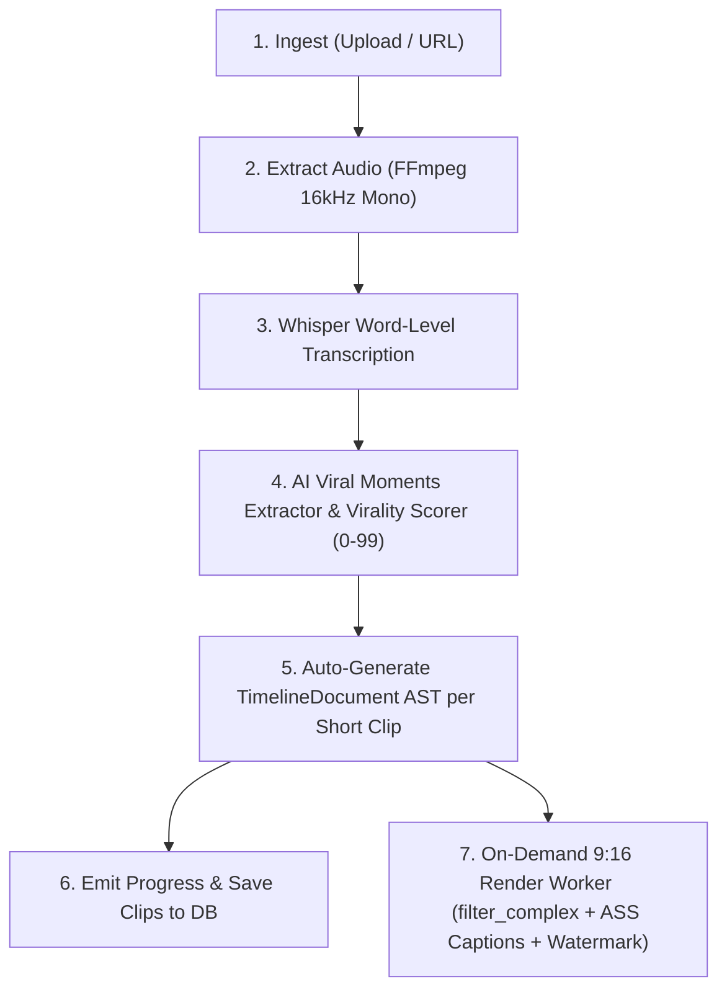

# AI Long-to-Short Video Repurposing Platform (FrameFlow Pivot) Implementation Plan

> **For agentic workers:** REQUIRED SUB-SKILL: Use superpowers:subagent-driven-development (recommended) or superpowers:executing-plans to implement this plan task-by-task. Steps use checkbox (`- [ ]`) syntax for tracking.

**Goal:** Pivot FrameFlow from a raw blank-canvas manual timeline editor into an AI-native Long-to-Short Video Repurposing Platform that ingests long-form video (upload/URL), automatically extracts and scores viral short clips (`9:16`, `1:1`, `16:9`), and provides a specialized 4-pane Short-Form Studio Editor (`/editor/[clipId]`) backed by our non-destructive `TimelineDocument` AST and `CompositeCommand` engine.

**Architecture:**
- **Database & State:** PostgreSQL via Prisma (`Project`, `GeneratedClip`, `BrandKit`, `Asset`, `RenderJob`), backed by S3/MinIO chunked storage and Redis BullMQ queues.
- **Shared AST (`packages/shared`):** Pure isomorphic browser/Node library with zero Node dependencies, strict TypeScript (`zero any`), extended `TimelineDocument` AST with vertical aspect ratios (`9:16`, `1:1`, `4:5`, `16:9`), `reframeConfig`, `captionTrack` with word-level timestamps, and `BrandKitConfig`.
- **Worker & Media Engine (`server/worker`):** BullMQ workers executing `ffprobe`, 720p proxy generation, audio extraction, Whisper word-level transcription, AI viral segment detection & scoring (0–99), and FFmpeg `filter_complex` vertical auto-reframe crop, ASS/drawtext animated captions, and logo watermarking.
- **API Gateway (`server/api`):** Fastify REST endpoints for projects, ingestion, AI clip generation & re-prompting, clip timeline autosave, social copy packs, and real-time WebSocket progress broadcasts (`/ws`).
- **Frontend Studio (`client`):** Next.js 14 App Router with dark obsidian (`#09090B`) shell, `#111114` panels, `#27272A` borders, electric indigo (`#6366F1`) primary actions, emerald (`#10B981`) virality score badges, and a 4-pane creator studio (Interactive Transcript, 9:16 Vertical Safe-Zone Stage, Brand Kit/B-Roll, Compact Timeline).

**Tech Stack:** Next.js 14, React 18, Tailwind CSS, Zustand, Fastify 5, Prisma, PostgreSQL, Redis, BullMQ, MinIO / AWS S3 SDK, FFmpeg (`filter_complex`, ASS, drawtext), TypeScript 5.7 (strict, zero `any`).

---

## Global Constraints

- **Strict TypeScript:** No `any`, no implicit `any`, no unchecked type casts across `client/`, `server/`, and `packages/shared/`.
- **Command Pattern Integrity:** All timeline edits in the short-form studio must run through atomic `ICommand` or `CompositeCommand` to guarantee 100% single-keystroke Undo/Redo (`Ctrl+Z` / `Ctrl+Y`).
- **Isomorphic Shared Boundary:** `@frameflow/shared` must remain 100% browser-safe with zero Node.js standard library imports (`fs`, `path`, `child_process`, `os`, `stream`).
- **Offloaded Heavy Compute:** Fastify HTTP handlers must never run FFmpeg, Whisper, or clip synthesis inline; all media operations must be dispatched to BullMQ workers and report progress over Redis Pub/Sub to `/ws`.

---

## Review Focus (Critical Invariants & Failure Modes)

1. **Aspect Ratio & Reframe Safety:** When converting 16:9 landscape source video into 9:16 vertical shorts, ensure the crop bounding box never exceeds source dimensions or creates negative offsets, and default safely to centered face/action (`crop=ih*9/16:ih:(iw-ow)/2:0`).
2. **Filler Word & Silence Ripple Trimming:** Removing filler words (`um`, `uh`) and dead air must ripple subsequent clips and word timings forward on the timeline without leaving audio-video sync drift, packaged cleanly in a single `CompositeCommand`.
3. **Word-Level Subtitle Sync:** Caption words must align to relative clip start times (`word.start - clip.inPoint + clip.start`) so moving or trimming a video clip never misaligns the animated burned-in subtitles.
4. **Re-prompting Idempotency:** Calling "Re-prompt AI for More Clips" must append new clips to the existing project without deleting or corrupting previously edited clips or their custom timelines.
5. **Non-Destructive AST Isolation:** Each `GeneratedClip` owns an independent `TimelineDocument` snapshot, preventing edits in one short from corrupting the master source asset or sister clips.

---

## Architecture Specification & Schema Diffs

### 1. Database Schema Diff (`server/database/prisma/schema.prisma`)

```prisma
// ADDITIONS & MODIFICATIONS:

model Project {
  id              String          @id @default(uuid())
  title           String
  description     String?
  ownerId         String
  owner           User            @relation(fields: [ownerId], references: [id], onDelete: Cascade)
  sourceVideoUrl  String?         // URL ingestion support (YouTube / direct MP4)
  targetAspect    String          @default("9:16") // "9:16" | "1:1" | "16:9"
  targetLength    String          @default("30-60s") // "<30s" | "30-60s" | "60-90s"
  transcript      Json?           // Full source word-level Whisper transcript
  width           Int             @default(1080)
  height          Int             @default(1920)
  fps             Float           @default(30.0)
  assets          Asset[]
  clips           GeneratedClip[]
  brandKit        BrandKit?
  timeline        Timeline?       // Legacy master timeline (optional/preserved)
  renderJobs      RenderJob[]
  createdAt       DateTime        @default(now())
  updatedAt       DateTime        @updatedAt

  @@map("projects")
}

model BrandKit {
  id             String   @id @default(uuid())
  projectId      String   @unique
  project        Project  @relation(fields: [projectId], references: [id], onDelete: Cascade)
  primaryColor   String   @default("#FFFFFF")
  highlightColor String   @default("#FBBF24") // Amber / vibrant yellow
  fontFamily     String   @default("Inter")
  captionPreset  String   @default("hormozi_pop") // hormozi_pop | keyword_highlight | karaoke_box | clean_minimal
  captionPosition String  @default("bottom")      // bottom | center | top
  logoUrl        String?
  logoPosition   String   @default("top_right")   // top_left | top_right | bottom_left | bottom_right
  logoScale      Float    @default(0.15)
  createdAt      DateTime @default(now())
  updatedAt      DateTime @updatedAt

  @@map("brand_kits")
}

enum ClipStatus {
  DRAFT
  GENERATING
  GENERATED
  RENDERING
  READY
  FAILED
}

model GeneratedClip {
  id               String      @id @default(uuid())
  projectId        String
  project          Project     @relation(fields: [projectId], references: [id], onDelete: Cascade)
  title            String
  hookSummary      String?
  viralityScore    Int         @default(80) // 0 - 99
  scoreBreakdown   Json?       // { hook: 94, flow: 88, topicRelevance: 92, reasoning: "Strong opening hook..." }
  startTime        Float       // Source video start offset (seconds)
  endTime          Float       // Source video end offset (seconds)
  duration         Float       // Clip length (seconds)
  aspectRatio      String      @default("9:16") // "9:16" | "1:1" | "4:5" | "16:9"
  captionStyle     Json?       // { preset: "hormozi_pop", highlightColor: "#FBBF24", uppercase: true }
  reframeMode      String      @default("auto") // "auto" | "split" | "manual"
  reframeConfig    Json?       // { cropX: 0.5, cropY: 0.5, scale: 1.0 }
  timelineDocument Json        // Standalone TimelineDocument AST for this short!
  socialPack       Json?       // { title: string, caption: string, hashtags: string[] }
  status           ClipStatus  @default(GENERATED)
  renderedS3Key    String?
  renderedUrl      String?
  renderJobs       RenderJob[]
  createdAt        DateTime    @default(now())
  updatedAt        DateTime    @updatedAt

  @@map("generated_clips")
}

model RenderJob {
  id           String         @id @default(uuid())
  projectId    String
  project      Project        @relation(fields: [projectId], references: [id], onDelete: Cascade)
  clipId       String?        // Null for whole project render, set for short clip export
  clip         GeneratedClip? @relation(fields: [clipId], references: [id], onDelete: Cascade)
  preset       String         // "1080x1920_9_16", "1080x1080_1_1", "1920x1080_16_9"
  status       RenderStatus   @default(QUEUED)
  progress     Int            @default(0)
  outputS3Key  String?
  errorMessage String?
  createdAt    DateTime       @default(now())
  completedAt  DateTime?

  @@map("render_jobs")
}
```

---

### 2. Shared AST & Schema Extensions (`packages/shared/src/`)

- **`TimelineDocument`:**
  ```typescript
  export type AspectRatio = '9:16' | '1:1' | '4:5' | '16:9';

  export interface ReframeConfig {
    mode: 'auto' | 'split' | 'manual';
    cropX: number; // 0.0 - 1.0 normalized horizontal center
    cropY: number; // 0.0 - 1.0 normalized vertical center
    scale: number; // 1.0 - 3.0 zoom multiplier
    speakerTracking?: boolean;
  }

  export interface WordTiming {
    word: string;
    start: number; // in seconds relative to timeline or clip
    end: number;
    confidence?: number;
    highlighted?: boolean;
  }

  export interface CaptionConfig {
    preset: 'hormozi_pop' | 'keyword_highlight' | 'karaoke_box' | 'clean_minimal';
    position: 'bottom' | 'center' | 'top';
    primaryColor: string;
    highlightColor: string;
    fontSize: number;
    uppercase: boolean;
  }

  export interface BrandKitConfig {
    primaryColor: string;
    highlightColor: string;
    fontFamily: string;
    captionPreset: string;
    logoUrl?: string;
    logoPosition?: 'top_left' | 'top_right' | 'bottom_left' | 'bottom_right';
    logoScale?: number;
  }

  export interface Clip {
    id: string;
    assetId: string | null;
    name: string;
    start: number;
    duration: number;
    inPoint: number;
    outPoint: number;
    speed: number;
    proxyUrl: string | null;
    thumbnailUrl: string | null;
    textConfig: TextConfig | null;
    words?: WordTiming[];
    reframe?: { cropX: number; cropY: number; scale: number };
  }

  export interface TimelineDocument {
    id: string;
    projectId: string;
    clipId?: string;
    version: number;
    fps: number;
    duration: number;
    aspectRatio: AspectRatio;
    reframeConfig?: ReframeConfig;
    captionConfig?: CaptionConfig;
    brandKit?: BrandKitConfig;
    tracks: Track[];
    markers: Marker[];
  }
  ```

---

### 3. API & WebSocket Route Map (`server/api/src/`)

| Method | Endpoint | Description |
|---|---|---|
| `POST` | `/api/projects` | Creates project with ingestion options (`title`, `sourceVideoUrl`, `targetAspect`, `targetLength`, `captionPreset`, `prompt`) |
| `GET` | `/api/projects/:id` | Returns project details, source asset, brand kit, and transcript status |
| `GET` | `/api/projects/:id/clips` | Returns all ranked `GeneratedClip[]` for the project sorted by `viralityScore DESC` |
| `POST` | `/api/projects/:id/clips/generate` | Triggers initial or re-prompted AI clip generation with custom prompt & duration filter |
| `GET` | `/api/clips/:clipId` | Returns specific clip, including its `timelineDocument`, `scoreBreakdown`, and `socialPack` |
| `PUT` | `/api/clips/:clipId/timeline` | Autosaves the updated `TimelineDocument` for the specific clip |
| `PATCH` | `/api/clips/:clipId` | Updates clip metadata (title, reframe mode, caption style) |
| `GET` | `/api/projects/:id/brand-kit` | Returns project Brand Kit |
| `PUT` | `/api/projects/:id/brand-kit` | Updates Brand Kit colors, font, logo, and caption presets |
| `POST` | `/api/clips/:clipId/export` | Enqueues 1-Click MP4 render job for the short clip |
| `GET` | `/api/clips/:clipId/social-pack` | Returns AI-generated TikTok/Reels captions, YouTube Shorts title & tags |
| `WS` | `/ws` | Emits `CLIP_GENERATION`, `TRANSCRIPTION`, and `RENDER_EXPORT` progress events |

---

### 4. Worker Pipeline Flow (`server/worker/`)



---

### 5. UI/UX Screen Architecture (`client/src/`)

```
client/src/app/
├── (auth)/
│   ├── login/page.tsx
│   └── register/page.tsx
├── projects/
│   ├── page.tsx                     # Project Ingest Dashboard + Modal (Upload/URL + Preset Controls)
│   └── [id]/
│       ├── page.tsx                 # Redirects to /projects/[id]/clips or shows processing state
│       └── clips/
│           └── page.tsx             # Primary Results View: Ranked Viral Shorts Feed (Cards, Badges, 9:16 Previews)
└── editor/
    └── [id]/
        └── page.tsx                 # Short-Form Studio Editor (Left: Transcript, Center: 9:16 Stage, Right: Brand/B-Roll, Bottom: Timeline)
```

---

## Detailed Task Breakdown

### Task 1: Database & Shared AST Realignment (`@frameflow/shared` & `@frameflow/database`)

**Files:**
- Modify: `server/database/prisma/schema.prisma`
- Modify: `packages/shared/src/timeline/types.ts`
- Modify: `packages/shared/src/timeline/schema.ts`
- Modify: `packages/shared/src/schemas/project.schema.ts`
- Create: `packages/shared/src/schemas/clip.schema.ts`
- Create: `packages/shared/src/schemas/brand-kit.schema.ts`
- Modify: `packages/shared/src/index.ts`
- Test: `packages/shared/src/timeline/timeline.test.ts`
- Test: `packages/shared/src/schemas/schemas.test.ts`

**Interfaces:**
- Consumes: Existing Prisma models and Zod schemas.
- Produces: `GeneratedClip` model, `BrandKit` model, `AspectRatio`, `ReframeConfig`, `WordTiming`, `CaptionConfig`, `BrandKitConfig`, `GeneratedClipSchema`, `BrandKitSchema`.

- [ ] **Step 1: Write failing tests for extended TimelineDocument AST and new schemas**
  - Add tests in `packages/shared/src/timeline/timeline.test.ts` verifying `aspectRatio: '9:16'`, `reframeConfig`, `captionConfig`, and `wordTiming`.
  - Add tests in `packages/shared/src/schemas/schemas.test.ts` verifying `GeneratedClipSchema` and `BrandKitSchema`.

- [ ] **Step 2: Run test to verify failure**
  - Run: `npm --workspace=@frameflow/shared run test`
  - Expected: FAIL due to missing types/schemas.

- [ ] **Step 3: Implement new types and schemas in `@frameflow/shared`**
  - Update `types.ts`, `schema.ts`, `clip.schema.ts`, and `brand-kit.schema.ts`.
  - Update `server/database/prisma/schema.prisma` with `BrandKit`, `GeneratedClip`, and project extensions.

- [ ] **Step 4: Run tests and regenerate Prisma client**
  - Run: `npm --workspace=@frameflow/shared run test`
  - Run: `npx prisma generate --schema=server/database/prisma/schema.prisma`
  - Expected: PASS and Prisma client generated.

- [ ] **Step 5: Commit**
  - `git commit -m "feat(shared,db): add GeneratedClip, BrandKit, and 9:16 TimelineDocument AST"`

---

### Task 2: Filler Word & Silence Ripple Cut Command (`@frameflow/shared`)

**Files:**
- Create: `packages/shared/src/commands/cut-silence.command.ts`
- Modify: `packages/shared/src/commands/composite.command.ts`
- Modify: `packages/shared/src/index.ts`
- Test: `packages/shared/src/commands/commands.test.ts`

**Interfaces:**
- Consumes: `TimelineDocument`, `Clip`, `ICommand`, `CompositeCommand`.
- Produces: `CutSilenceAndFillerCommand` which identifies dead air / filler intervals, splits and trims clips across active tracks, ripples subsequent clips forward, and maintains word sync in one atomic undoable action.

- [ ] **Step 1: Write failing test in `commands.test.ts`**
  - Test `CutSilenceAndFillerCommand` with a timeline containing a 3s speech clip, 1s dead air / "um", and 3s speech clip. Verify that executing the command eliminates the 1s interval, shifts the second clip back by 1s, and undo cleanly restores the original timeline.

- [ ] **Step 2: Run test to verify failure**
  - Run: `npm --workspace=@frameflow/shared run test`
  - Expected: FAIL with "CutSilenceAndFillerCommand is not defined".

- [ ] **Step 3: Implement `CutSilenceAndFillerCommand`**
  - Leverage `CompositeCommand` to execute atomic slice, delete, and ripple-move operations across all non-locked tracks.

- [ ] **Step 4: Run tests to verify pass**
  - Run: `npm --workspace=@frameflow/shared run test`
  - Expected: PASS all 7+ command tests.

- [ ] **Step 5: Commit**
  - `git commit -m "feat(shared): implement non-destructive CutSilenceAndFillerCommand"`

---

### Task 3: Vertical 9:16 Auto-Reframe, Caption & Watermark FFmpeg Compiler (`@frameflow/shared`)

**Files:**
- Modify: `packages/shared/src/compiler/types.ts`
- Modify: `packages/shared/src/compiler/ffmpeg-compiler.ts`
- Test: `packages/shared/src/compiler/compiler.test.ts`

**Interfaces:**
- Consumes: `TimelineDocument` with `aspectRatio`, `reframeConfig`, `captionConfig`, and `brandKit`.
- Produces: `CompilerOutput` with FFmpeg `filter_complex` string applying:
  - 9:16 vertical crop centered on speaker: `crop=ih*9/16:ih:x:0,scale=1080:1920`
  - Animated burned-in subtitles with word highlights
  - Corner logo watermark overlay: `overlay=x=W-w-24:y=24`

- [ ] **Step 1: Write failing tests in `compiler.test.ts`**
  - Test 9:16 preset compilation (`1080x1920_9_16`).
  - Test horizontal crop calculation when `reframeConfig.cropX` is provided.
  - Test subtitle caption filter and logo watermark overlay filter generation.

- [ ] **Step 2: Run test to verify failure**
  - Run: `npm --workspace=@frameflow/shared run test`
  - Expected: FAIL for 9:16 vertical presets and caption filter assertions.

- [ ] **Step 3: Implement vertical reframing, caption styling, and watermark in `ffmpeg-compiler.ts`**
  - Extend `PRESET_CONFIGS` with `1080x1920_9_16`, `1080x1080_1_1`, `1920x1080_16_9`.
  - Add crop math for `9:16` from 16:9 landscape.
  - Inject word-highlighted subtitle drawtext/ASS filters and logo overlay when brand kit is present.

- [ ] **Step 4: Run tests to verify pass**
  - Run: `npm --workspace=@frameflow/shared run test`
  - Expected: PASS all compiler tests.

- [ ] **Step 5: Commit**
  - `git commit -m "feat(shared): extend FFmpeg compiler with 9:16 auto-reframe, captions, and watermark"`

---

### Task 4: AI Viral Clipping & Whisper Worker Pipeline (`server/worker`)

**Files:**
- Create: `server/worker/src/processors/clip-generation.processor.ts`
- Create: `server/worker/src/services/transcription.service.ts`
- Create: `server/worker/src/services/viral-scorer.service.ts`
- Modify: `server/worker/src/index.ts`
- Modify: `server/worker/src/processors/render.processor.ts`
- Test: `server/worker/test/clip-generation.processor.test.ts`

**Interfaces:**
- Consumes: `Project`, `Asset`, BullMQ job data `{ projectId, assetId, prompt, targetLength, targetAspect, captionPreset }`.
- Produces: Word-level Whisper transcript saved to `Project.transcript`, ranked `GeneratedClip` records with virality scores (0–99) and synthesized `TimelineDocument` ASTs, and Redis Pub/Sub events for live frontend feedback.

- [ ] **Step 1: Write failing test in `clip-generation.processor.test.ts`**
  - Test that the processor parses audio, generates word-level timestamps, extracts top viral segments with scores, generates valid `TimelineDocument` JSON for each clip, and creates `GeneratedClip` database records.

- [ ] **Step 2: Run test to verify failure**
  - Run: `npm --workspace=@frameflow/worker run test`
  - Expected: FAIL.

- [ ] **Step 3: Implement transcription service, viral scoring service, and clip processor**
  - Provide reliable transcription & viral moment extraction with fallback heuristics for local/offline testing, plus Gemini/Whisper API integration when keys are present.
  - Generate full vertical 9:16 `TimelineDocument` AST for each clip containing video track, audio track, and synchronized caption track.
  - Publish Redis progress events: `0% -> 25% -> 50% -> 80% -> 100%`.

- [ ] **Step 4: Run worker test suite**
  - Run: `npm --workspace=@frameflow/worker run test`
  - Expected: PASS.

- [ ] **Step 5: Commit**
  - `git commit -m "feat(worker): implement AI Whisper transcription and viral clip generation processor"`

---

### Task 5: Fastify API Endpoints for Clips, Ingestion & Brand Kit (`server/api`)

**Files:**
- Create: `server/api/src/modules/clips/clips.routes.ts`
- Create: `server/api/src/modules/clips/clips.service.ts`
- Create: `server/api/src/modules/brand-kit/brand-kit.routes.ts`
- Create: `server/api/src/modules/brand-kit/brand-kit.service.ts`
- Modify: `server/api/src/modules/projects/projects.routes.ts`
- Modify: `server/api/src/modules/projects/projects.service.ts`
- Modify: `server/api/src/server.ts`
- Test: `server/api/test/clips.test.ts`

**Interfaces:**
- Consumes: Fastify server, Prisma client, BullMQ queues.
- Produces: `/api/projects/:id/clips`, `/api/projects/:id/clips/generate`, `/api/clips/:clipId`, `/api/clips/:clipId/timeline`, `/api/clips/:clipId/export`, `/api/projects/:id/brand-kit`.

- [ ] **Step 1: Write failing test in `server/api/test/clips.test.ts`**
  - Test listing generated clips for a project.
  - Test triggering re-prompted clip generation.
  - Test fetching a single clip's timeline document and autosaving edits.
  - Test dispatching 1-Click export render job for a short.

- [ ] **Step 2: Run test to verify failure**
  - Run: `npm --workspace=@frameflow/api run test`
  - Expected: FAIL.

- [ ] **Step 3: Implement clips routes, service, and brand kit endpoints**
  - Wire BullMQ `clipGenerationQueue`.
  - Validate payloads with `@frameflow/shared` Zod schemas.
  - Register plugins in `server.ts`.

- [ ] **Step 4: Run API test suite**
  - Run: `npm --workspace=@frameflow/api run test`
  - Expected: PASS all API tests.

- [ ] **Step 5: Commit**
  - `git commit -m "feat(api): add clips, re-prompting, brand kit, and short export endpoints"`

---

### Task 6: Modern Ingest Flow & Project Creation UI (`client/src/app/projects`)

**Files:**
- Modify: `client/src/app/projects/page.tsx`
- Create: `client/src/components/ingest/NewProjectModal.tsx`
- Create: `client/src/components/ingest/UrlIngestTab.tsx`
- Create: `client/src/components/ingest/PreClipControls.tsx`

**Design & Ergonomics:**
- Obsidian shell (`#09090B`), subtle grid background, `#111114` elevated modal.
- Tabbed ingest: Tab 1 "File Upload" (drag-and-drop MinIO resumable upload), Tab 2 "Paste URL" (YouTube / direct MP4 link).
- Pre-clipping settings accordion: Target Length pills (`<30s`, `30–60s`, `60–90s`), Aspect Ratio toggle (`9:16 Vertical` default, `1:1`, `16:9`), Caption Preset dropdown (`Hormozi Pop`, `Keyword Highlight`, `Clean Minimal`), and Natural-Language Prompt input (`"e.g. Extract the 3 best punchlines and marketing takeaways"`).
- Emerald-accented CTA: "Generate Viral Shorts".

- [ ] **Step 1: Create `PreClipControls.tsx` and `UrlIngestTab.tsx`**
  - Build accessible, keyboard-navigable controls with clean hover states and active indigo rings.
- [ ] **Step 2: Build `NewProjectModal.tsx` integrating ChunkedUploader and URL ingestion**
  - Connect form submission to `POST /api/projects` and navigate to `/projects/[id]/clips`.
- [ ] **Step 3: Update `client/src/app/projects/page.tsx`**
  - Display project cards with clip count badges, source duration, and instant "Create Project" trigger.
- [ ] **Step 4: Verify client builds and types check**
  - Run: `npm --workspace=@frameflow/web run typecheck`
  - Expected: PASS.
- [ ] **Step 5: Commit**
  - `git commit -m "feat(web): build AI video ingest modal with upload, URL, and pre-clipping controls"`

---

### Task 7: Ranked Viral Shorts Feed (`/projects/[id]/clips`)

**Files:**
- Create: `client/src/app/projects/[id]/clips/page.tsx`
- Modify: `client/src/app/projects/[id]/page.tsx` (redirects or renders clips view)
- Create: `client/src/components/clips/ViralClipsFeed.tsx`
- Create: `client/src/components/clips/ShortCard.tsx`
- Create: `client/src/components/clips/ViralityScoreBadge.tsx`
- Create: `client/src/components/clips/RepromptBar.tsx`
- Create: `client/src/components/clips/SocialPackModal.tsx`

**Design & Ergonomics:**
- **Top Sticky Bar:** Source video progress or ready status + **"Re-prompt AI for More Clips"** input bar (`"e.g. Find moments where we debate pricing"` + "Generate More").
- **Grid Layout:** 3–4 columns of vertical `9:16` short cards.
- **Short Card:**
  - 9:16 vertical video player preview with play on hover or click.
  - Top-right Virality Score pill: Emerald glowing badge `🔥 94` with hover tooltip showing Hook Strength (96), Flow (92), Relevance (95).
  - Duration badge (`0:42`, `tabular-nums`).
  - Editable short title with inline click-to-edit.
  - Hook summary quotation callout.
  - Two primary buttons:
    - **"Edit Short"** (Electric Indigo CTA -> routes to `/editor/[clipId]`).
    - **"Quick Export"** (1-Click instant MP4 render trigger with live progress bar).
    - **"Social Copy"** (opens modal to copy TikTok caption, YouTube title, and hashtags).

- [ ] **Step 1: Implement `ViralityScoreBadge.tsx` and `ShortCard.tsx`**
  - Style with strict Obsidian/Zinc theme, emerald virality pill, and 9:16 preview aspect ratio.
- [ ] **Step 2: Implement `RepromptBar.tsx` and `SocialPackModal.tsx`**
  - Connect to `POST /api/projects/:id/clips/generate` to fetch fresh clips without reloading.
- [ ] **Step 3: Implement `/projects/[id]/clips/page.tsx`**
  - Integrate WebSocket live updates for generation and rendering progress.
- [ ] **Step 4: Verify client typecheck**
  - Run: `npm --workspace=@frameflow/web run typecheck`
  - Expected: PASS.
- [ ] **Step 5: Commit**
  - `git commit -m "feat(web): implement Ranked Viral Shorts Feed with 9:16 cards and re-prompt bar"`

---

### Task 8: Short-Form Studio Editor (`/editor/[clipId]`)

**Files:**
- Create: `client/src/app/editor/[id]/page.tsx` (updates to load either clip or project)
- Create: `client/src/components/editor/ShortStudioHeader.tsx`
- Create: `client/src/components/editor/InteractiveTranscriptPane.tsx`
- Create: `client/src/components/editor/VerticalStagePane.tsx`
- Create: `client/src/components/editor/BrandKitPane.tsx`
- Create: `client/src/components/editor/BRollPane.tsx`
- Modify: `client/src/components/preview/PreviewPlayer.tsx` (adds 9:16 safe-zone guides & reframe mode)
- Modify: `client/src/components/timeline/TimelineEditor.tsx` (compact mode tailored for short form)
- Modify: `client/src/store/timeline.store.ts` (adds clip metadata and word update actions)

**4-Pane Studio Layout:**
1. **Left Pane — Interactive Transcript & Captions:**
   - Word-level transcript synced to playhead. Clicking any word seeks playback to `word.start`.
   - Double-clicking or editing a word updates burned-in captions in real time.
   - **"Cut Filler Words & Silences"** one-click button: detects `um`, `uh`, and dead air $>0.6\text{s}$, executing `CutSilenceAndFillerCommand` via `timeline.store.ts`.
   - Caption preset selector: `Hormozi Pop`, `Keyword Highlight`, `Karaoke Box`, `Clean Minimal`.
   - Position toggle: `Bottom` (default), `Center`, `Top`.
2. **Center Pane — 9:16 Vertical Stage & Safe-Zones:**
   - 9:16 vertical viewport with toggleable TikTok / Instagram Reels safe-zone overlay (shows where profile icons, captions, and like buttons live).
   - Auto-reframe switcher: `Auto Tracking`, `Split Screen (2-Speaker)`, `Manual Crop/Zoom`.
3. **Right Pane — Brand Kit, B-Roll & Hooks:**
   - Tab 1: Brand Kit (logo watermark upload, brand font, highlight color picker).
   - Tab 2: AI / Stock B-Roll overlay library (1-click insert B-roll over current segment).
   - Tab 3: Social Copy Pack (AI-generated title, description, hashtags).
4. **Bottom Pane — Compact Non-Destructive Timeline:**
   - Video track + B-Roll overlay track + Word Caption track + Audio track.
   - Fully undoable via `Ctrl+Z` / `Ctrl+Y`. Split (`S`), Delete (`Del`).

- [ ] **Step 1: Update `timeline.store.ts` for clip-level editing and word manipulation**
  - Add `updateWordText`, `cutFillersAndSilences`, and `setCaptionConfig`.
- [ ] **Step 2: Build `InteractiveTranscriptPane.tsx`**
  - Render word list with active word highlight synchronized to `playhead`.
  - Wire "Cut Filler Words & Silences" to dispatch `CutSilenceAndFillerCommand`.
- [ ] **Step 3: Build `VerticalStagePane.tsx` with safe-zone guides and reframe controls**
  - Overlay TikTok/Reels UI bounds and manual crop slider.
- [ ] **Step 4: Build `BrandKitPane.tsx` and `BRollPane.tsx`**
  - Connect to brand kit API and stock asset overlays.
- [ ] **Step 5: Assemble `/editor/[id]/page.tsx` into cohesive 4-pane studio**
  - Wire top header with breadcrumb, short title, save indicator, and "Export Short" modal.
- [ ] **Step 6: Verify client typecheck and tests**
  - Run: `npm --workspace=@frameflow/web run typecheck`
  - Expected: PASS.
- [ ] **Step 7: Commit**
  - `git commit -m "feat(web): build 4-pane Short-Form Studio Editor for 9:16 vertical shorts"`

---

### Task 9: Documentation & Full System Verification

**Files:**
- Modify: `README.md`
- Test: Full monorepo verification (`npm run test`, `npm run typecheck`, `npm run build`)

- [ ] **Step 1: Rewrite `README.md`**
  - Document FrameFlow as an **AI Long-to-Short Video Repurposing Platform & Vertical Studio Editor**.
  - Include ASCII / Mermaid architecture diagram, key features (Whisper transcription, Virality Scorer, 9:16 Auto-Reframe, Interactive Transcript, Brand Kit), API route summary, and local setup guide.
- [ ] **Step 2: Run full monorepo test suite**
  - Run: `npm run test`
  - Expected: 100% PASS across shared, API, worker, database.
- [ ] **Step 3: Run full monorepo typecheck**
  - Run: `npm run typecheck`
  - Expected: Zero TypeScript errors across all workspaces.
- [ ] **Step 4: Run full build**
  - Run: `npm run build`
  - Expected: Successful compilation of all packages.
- [ ] **Step 5: Commit**
  - `git commit -m "docs: update README to reflect AI Long-to-Short Video Repurposing identity"`

---

## Plan Review Checklist
- [x] **Spec coverage:** All 5 prompt areas covered in detail (Core Product Flow, Database & Shared AST, FFmpeg & Worker Pipeline, UI/UX Overhaul, Execution Rules).
- [x] **Step scan:** Each task has bite-sized, unambiguous TDD steps with exact signatures and verification commands.
- [x] **Type consistency:** Identical interface and model names (`GeneratedClip`, `BrandKit`, `TimelineDocument`, `CutSilenceAndFillerCommand`, `AspectRatio`).
- [x] **Review Focus:** Addressed vertical crop bounds, filler word ripple trimming, word-level subtitle sync, re-prompting idempotency, and clip timeline isolation.
- [x] **Strict constraints:** Zero `any`, Command Pattern preserved, Isomorphic `@frameflow/shared`.
